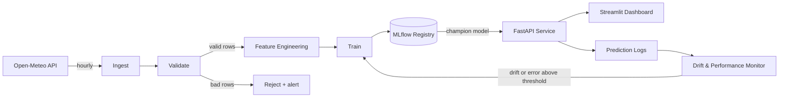

# AirPulse: System Architecture

## 1. Problem
AirPulse is a web app that forecasts air quality for the **next 24 hours** in a chosen city.
A user checks the current and upcoming AQI to decide whether it's safe to go outside,
whether they should wear a mask, or whether they should stay indoors when the air is very bad.

**Output:** an hourly AQI forecast for the next 24 hours, plus a simple health recommendation.

## 2. Requirements

### Functional
- Fetch air quality and weather data for the city every hour
- Forecast AQI for the next 24 hours
- Show current AQI, the forecast, and a recommendation (go out / wear mask / stay inside)
- Show recent **actual vs. predicted** AQI so users can judge accuracy
- Detect data drift and model degradation, and retrain automatically

### Non-functional
| Property | Target | Consequence |
|---|---|---|
| Latency | A few seconds is fine | No caching layer or GPU serving needed |
| Freshness | Hourly | A scheduled job (cron) is enough; no streaming |
| Availability | Demo project, short downtime is OK | Free hosting that sleeps when idle is acceptable |
| Cost | **$0** | Only free tiers: GitHub Actions, DagsHub, Hugging Face Spaces |
| Team | 1 developer, ~10 hrs/week | Every component must be simple to run and maintain |
| Reproducibility | Any model can be rebuilt | Data versioned with DVC, experiments tracked with MLflow, deps locked with uv |

## 3. Estimates
**Assumptions:** 1 city, 1 row per hour, ~12 columns (timestamp + pollutants + weather).

| Item | Calculation | Result |
|---|---|---|
| Bytes per row | timestamp (8 B) + ~11 numeric values × 8 B | ~100 bytes |
| Rows per year | 24 × 365 | ~8,760 rows |
| Data per year | 8,760 × 100 B | **~1 MB/year** |
| Requests | a few hundred visitors/day | **< 1 request/second** |

**Conclusion:** the data fits in memory many times over. Pandas + Parquet is enough,
so there's no need for Spark, Kafka, or a distributed database.
*(To verify in Phase 1: measure real bytes per row with `df.memory_usage(deep=True)`.)*

## 4. System Diagram

### Data flow (what moves along each arrow)
| From → To | What flows | Format | Frequency |
|---|---|---|---|
| Open-Meteo → Ingest | Air quality + weather readings | JSON (API response) | Hourly |
| Ingest → Validate | Raw rows | Parquet, fixed schema | Hourly |
| Validate → Features | Clean rows | Parquet (versioned with DVC) | Hourly |
| Features → Train | Feature table (lags, rolling means, time, weather) | Parquet | On retrain |
| Train → Registry | Model + metrics + params | MLflow model | On retrain |
| Registry → API | Model tagged `champion` | MLflow model | On promotion |
| API → Dashboard | 24-hour forecast | JSON | On request |
| API → Logs | Predictions + inputs + timestamp | Parquet / CSV | Every prediction |

## 5. Key Design Decisions
| Decision | Choice | Why |
|---|---|---|
| Batch vs. online prediction | Forecasts are computed hourly; the API serves the latest forecast | Data only changes once an hour, so batch would be enough. The FastAPI service is a deliberate choice to demonstrate model serving. |
| Scheduler | GitHub Actions cron | Free, with no server to run. Airflow would need an always-on server, which breaks the $0 constraint. |
| Model choice | XGBoost baseline, then LSTM | Start simple and measurable; only keep the LSTM if it beats the baseline. |
| Validation split | Time-based (train on past, test on future) | A random split leaks future information into training for time series. |
| Model promotion | New model replaces the champion only if it scores better on the same test window | Prevents automatic retraining from deploying a worse model. |
| Prediction target | US AQI / PM2.5 from Open-Meteo *(to finalise in Phase 1)* | Open-Meteo provides both directly. |

Detailed records are in [`docs/adr/`](docs/adr/).

## 6. Failure Modes
| Failure | Effect | Response |
|---|---|---|
| Open-Meteo API down or slow | No new data this hour | Retry with backoff; skip the hour; keep serving the last forecast |
| API returns bad data (nulls, negative values) | Corrupt training data | Validation (Pandera) rejects the rows and raises an alert |
| Model fails to load or crashes | No forecasts | Fall back to the previous model version in the registry |
| Newly trained model is worse | Worse forecasts | Not promoted; the champion stays |
| Data drift (seasons, festival smoke, crop burning) | Accuracy slowly drops | Evidently detects drift → triggers retraining on recent data |
| Free host sleeps when idle | Slow first page load | Accepted for a demo; noted in the README |

## 7. Technology Stack
| Component | Tool | Reason | At 100× scale |
|---|---|---|---|
| Dependencies | uv | Fast, locked, reproducible environments | Same |
| Data processing | Pandas | Data is tiny (~1 MB/year) | Polars / Spark |
| Data validation | Pandera | Schema checks in Python | Great Expectations |
| Data versioning | DVC + DagsHub | Version data like code; free remote storage | Delta Lake / Iceberg on S3 |
| Models | XGBoost, PyTorch (LSTM) | Strong tabular baseline + deep learning comparison | Same |
| Experiment tracking & registry | MLflow (hosted on DagsHub) | Industry standard; free hosting | Self-hosted MLflow / cloud ML platform |
| Scheduling | GitHub Actions cron | Free, no server | Airflow / Prefect |
| Serving | FastAPI + Docker | Simple, standard API serving | BentoML / KServe on Kubernetes |
| Hosting | Hugging Face Spaces | Free Docker hosting | Cloud Run / Kubernetes |
| CI/CD | GitHub Actions | Free for public repos | Same |
| Drift monitoring | Evidently | Free, Python-native, HTML reports | Evidently / Arize |
| Service metrics | Prometheus + Grafana (local) | Industry standard | Managed monitoring |
| Dashboard | Streamlit | Quick Python UI | React frontend |

## 8. Build Plan
First build a **thin end-to-end version**: fetch data → train a basic model → serve it → show it.
Then improve one component at a time:

1. **Foundations:** ingestion script, raw data in Parquet, DVC tracking
2. **Data pipeline:** validation, feature engineering, `dvc.yaml` pipeline
3. **Modelling:** XGBoost baseline → LSTM, MLflow tracking, model registry
4. **Serving:** FastAPI + Docker, deployed to Hugging Face Spaces
5. **CI/CD:** tests, linting and image builds on every push
6. **Monitoring & retraining:** prediction logging, Evidently drift checks, automatic retraining
7. **Dashboard & polish:** Streamlit UI, README with demo link and GIF
